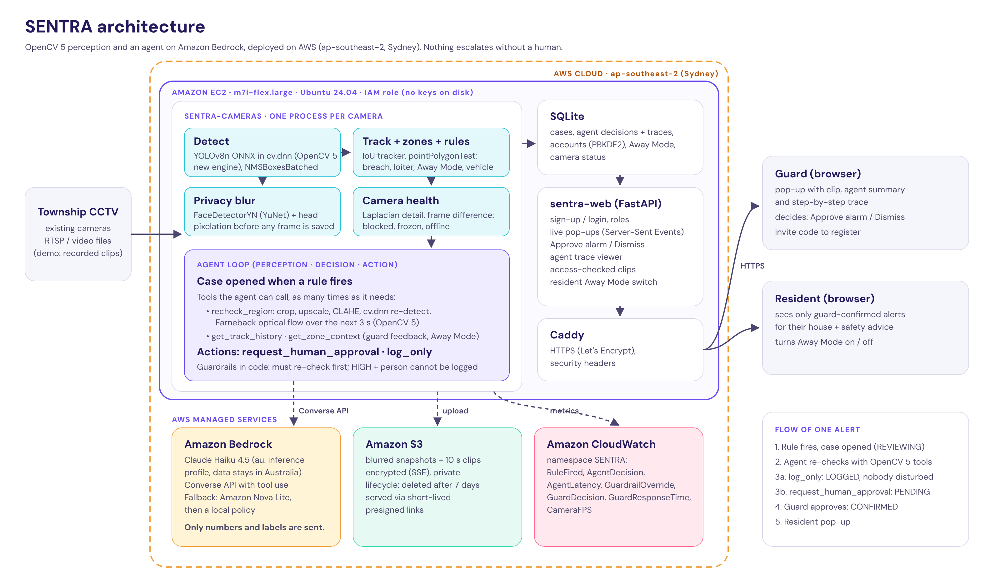
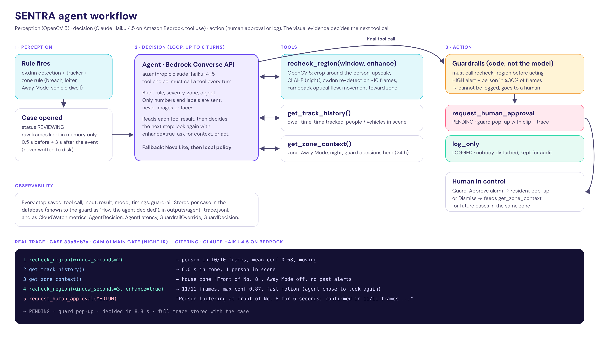

# SENTRA: agentic CCTV triage with OpenCV 5 and AWS
**Technical report · OpenCV AI Competition 2026, powered by AWS · Agentic Vision path**
Team Codex, Universiti Teknologi PETRONAS, Malaysia

Live endpoint: https://13-239-96-244.sslip.io · Code: https://github.com/farah-aleya/SENTRA_CodeX

---

## 1. Problem
Malaysian gated townships already pay for CCTV, but cameras do not stop intruders: people watching them do.
A guard house is responsible for many cameras at once, so guards either miss events or drown in motion alerts.
Two failures come up again and again in township security:
- **Alert fatigue.** Simple motion or zone rules fire on shoppers, delivery riders, rain and shadows. Guards learn to ignore them.
- **Silent cameras.** Cameras that are covered, frozen or offline look installed but record nothing.

At the same time, residents expect privacy: they do not want a system that identifies their faces or sends video of their homes to third parties.

**Goal.** Turn existing CCTV into a system that (1) finds behaviour that matters, (2) checks its own alerts before disturbing anyone, (3) keeps a human in charge of every alarm, and (4) protects the privacy of everyone on camera.

## 2. Users
| User | Needs | What SENTRA gives them |
|---|---|---|
| Guard on duty | few, credible alerts; fast decision | a pop-up only when the agent thinks it matters, with the 10 s clip, a one-line summary and the agent's evidence; one-tap Approve alarm or Dismiss |
| Resident | to know when something real happens at home; privacy | only guard-confirmed alerts for their own house, with safety advice; an Away Mode switch for holidays |
| Township management | proof the system works; camera uptime | camera health alerts, false-alarm rate and response-time KPIs, CloudWatch metrics |

## 3. System overview

One process per camera runs the perception pipeline and the agent; a FastAPI web app serves guards and residents; both run as systemd services on one EC2 instance behind Caddy (HTTPS). Amazon Bedrock hosts the agent's model, Amazon S3 stores blurred evidence for 7 days, and Amazon CloudWatch receives metrics. The instance reaches all three through an IAM role with a least-privilege policy.

Life of one alert:
1. A zone rule fires (for example, a person inside the restricted "Gate No. 8" zone). A **case** is opened with status `REVIEWING`, a blurred snapshot and a 10-second blurred clip (4 s before, 6 s after).
2. The **agent** re-examines the case with OpenCV 5 tools and context tools, then calls one of two actions.
3. `log_only` → status `LOGGED`. Nobody is disturbed; the case stays in the audit log.
4. `request_human_approval` → status `PENDING`. The guard gets a live pop-up (Server-Sent Events) with the clip, the agent's summary and its full trace.
5. The guard presses **Approve alarm** (`CONFIRMED`, the resident gets a pop-up) or **Dismiss** (`DISMISSED`, which the agent sees next time through `get_zone_context`).

## 4. OpenCV 5 implementation
**Detection.** YOLOv8n (COCO, 80 classes) is exported once to ONNX with dynamic input size and run with `cv.dnn.readNetFromONNX` on the **OpenCV 5 new DNN engine** (`ENGINE_AUTO`, which selects the new graph engine). The dynamic shape lets the night-IR camera use a 960 px input while other cameras use 640 px with the same file; the classic engine cannot load this model. Pre-processing is a letterbox plus `cv.dnn.blobFromImage`; post-processing decodes the 84 × N output, keeps the five classes SENTRA uses (person, car, motorcycle, bus, truck) and applies `cv.dnn.NMSBoxesBatched` per class. PyTorch and Ultralytics are no longer needed at run time.

**Tracking.** A ByteTrack-style two-stage IoU tracker (high- then low-confidence detections, constant-velocity prediction, people never matched to vehicles) gives stable IDs for dwell times.

**Zones and rules.** Zones are polygons in relative coordinates; a person's foot point is tested with `cv.pointPolygonTest`. Rules: perimeter breach (restricted zone), Away Mode breach (any person at a house marked away), loitering (dwell over a threshold) and vehicle dwell, each with a grace period and per-zone cooldown.

**Camera health.** On a 160 px greyscale thumbnail: `cv.Laplacian` variance and brightness detect a covered or sprayed lens, mean absolute frame difference detects a frozen picture, and missing frames detect an offline camera. Each check has a learned baseline and sends a RESTORED message.

**Privacy.** Before any frame is drawn, saved or streamed, `cv.FaceDetectorYN` (YuNet, OpenCV Zoo) finds faces and SENTRA pixelates them, then also pixelates the head area of every person box (back of the head, night, small faces). The raw frame exists only in memory for detection and the agent's re-check.

**Agent tool `recheck_region` (pure OpenCV 5).** For the ~10 frames after the event it crops the area around the tracked person (2× the box, at least 160 px), upscales it to 640 px with `INTER_CUBIC`, optionally applies `createCLAHE` to the L channel in LAB for dark or IR video, runs a second `cv.dnn` detection on the crop, computes `calcOpticalFlowFarneback` between consecutive crops, and measures whether the foot point moves toward the zone centre. It also reports `low_light` (mean grey level) and `night_infrared` (colourfulness of the frame centre). This tool runs on its own `cv.dnn.Net` instance because DNN networks must not be shared between threads.

## 5. Agent design

- **Model and API.** Amazon Bedrock Converse API with tool use, `au.anthropic.claude-haiku-4-5-20251001-v1:0` (Australian cross-region inference profile, so requests stay in Australian regions), temperature 0, `toolChoice: any` so the model must call a tool on every turn, up to 6 turns. Fallback chain: Amazon Nova Lite (`apac.amazon.nova-lite-v1:0`), then a local policy that uses the same OpenCV tool with fixed thresholds.
- **Tools.** `recheck_region(window_seconds, enhance)`, `get_track_history()`, `get_zone_context()`; actions `request_human_approval(priority, summary, evidence)` and `log_only(reason)`.
- **How vision changes the plan.** The system prompt tells the agent to look again with `enhance=true` and a longer window when the first re-check is weak (low light, low confidence, few frames), and to treat `low_light`/`night_infrared` as night for recorded video. In the trace above the agent called `recheck_region` a second time after its first look, and only then asked for human approval.
- **Guardrails in code.** (1) A final action before any `recheck_region` call is rejected and returned to the model as a tool error. (2) A HIGH-severity case (perimeter or Away Mode breach) can only be logged if OpenCV confirmed the person in fewer than 30% of re-checked frames; otherwise the decision is overridden to `request_human_approval` and the override is recorded. (3) Any error ends in human review, never in silence.
- **Data minimisation.** The model receives only text: rule, zone name, counts, confidences, motion level. No image, face or clip is sent to Bedrock.
- **Observability.** Every tool call, tool result, model reply, guardrail and timing is stored with the case, shown to the guard as "How the agent decided", written to `outputs/agent_trace.jsonl`, and summarised as CloudWatch metrics.

## 6. AWS deployment
| Component | Configuration |
|---|---|
| Compute | Amazon EC2 `m7i-flex.large` (2 vCPU, 8 GiB), Ubuntu 24.04, 20 GB gp3, ap-southeast-2 |
| Services | `sentra-web` (FastAPI, Uvicorn, 127.0.0.1:8000), `sentra-cameras` (one OpenCV process per camera), Caddy reverse proxy with automatic Let's Encrypt HTTPS and security headers |
| Model | Amazon Bedrock, Claude Haiku 4.5 via the `au.` inference profile; Nova Lite fallback |
| Storage | Amazon S3 bucket, private, SSE-S3 encryption, lifecycle rule deletes `clips/` and `snapshots/` after 7 days; media older than the local copy is served through 5-minute presigned URLs after the app's own access check |
| Observability | CloudWatch namespace `SENTRA`: RuleFired, AgentDecision, AgentLatency, GuardrailOverride, GuardDecision, GuardResponseTime, CameraFPS; logs in journald |
| Identity | EC2 instance role with a policy limited to `bedrock:InvokeModel`, the one S3 bucket, and `cloudwatch:PutMetricData` restricted to the SENTRA namespace. No access keys on the server. |
| Reproducibility | `deploy/setup_ec2.sh` installs and starts everything with one command; pinned `requirements.txt`; settings in `/etc/sentra.env` (random guard invite code and session secret generated on first install) |

## 7. Evaluation
### 7.1 OpenCV 5 runtime vs the original PyTorch runtime
Same YOLOv8n weights, two runtimes, CPU only (2 cores). Script: `scripts/eval_detector.py`, raw output `eval/detector_results.json`.

**Labelled images (COCO128, 128 images; person and vehicle classes only, IoU ≥ 0.5).**

| Runtime | Person AP50 | Person precision / recall @0.35 | Vehicle AP50 | Vehicle precision / recall @0.35 |
|---|---|---|---|---|
| OpenCV 5 `cv.dnn` (SENTRA) | **0.768** | 0.915 / 0.594 | **0.396** | 0.870 / 0.286 |
| Ultralytics + PyTorch (old SENTRA) | 0.766 | 0.886 / 0.583 | 0.391 | 0.955 / 0.300 |

COCO128 is drawn from the COCO training split that YOLOv8n was trained on, so the absolute numbers are optimistic; the test shows that moving to OpenCV 5 did **not** reduce accuracy.

**CCTV frames (150 frames from 5 clips, no labels): agreement between the two runtimes.**
234 OpenCV 5 boxes vs 225 PyTorch boxes, 213 matched: **agreement F1 = 0.93**, mean IoU of matched boxes **0.98**, mean confidence difference **0.026**.

**Speed (end-to-end detection per frame incl. pre/post-processing, runtimes measured separately).**
OpenCV 5 new engine **103 ms (9.7 FPS)** vs PyTorch **78 ms (12.9 FPS)** on 2 CPU cores. OpenCV 5 is about 25% slower on this CPU but removes the PyTorch dependency (hundreds of MB) from the deployment; 9–10 FPS is enough for CCTV behaviour rules, which work on seconds.

### 7.2 Agent vs rules only
**Setup.** `config/eval.yaml` defines 8 test cameras on 8 clips with zones, and `eval/labels.yaml` gives the ground truth for every camera and rule, labelled by the team after watching each clip: **real** (a guard should look: climbing a gate or fence, a person at an Away Mode house, a person waiting at a door or gate at night) or **benign** (normal activity: shoppers and pedestrians in the daytime rain, a passer-by, a visitor). Each clip is run once per mode with `scripts/eval_agent.py`; camera-health alerts are excluded because they do not pass through the agent. *Rules only* means every rule hit goes to the guard (the original SENTRA).

**Main result: Bedrock agent vs rules only, on the same 11 cases** (Windows laptop, Claude Haiku 4.5, `eval/agent_results_bedrock.json`, full traces in `eval/bedrock_traces.jsonl`).

| | Rules only | **SENTRA agent (Bedrock)** |
|---|---|---|
| Rule cases | 11 (7 real, 4 benign) | 11 (7 real, 4 benign) |
| Alerts sent to the guard | 11 | **7** |
| Real events sent to the guard (recall) | 7 / 7 | **7 / 7 (100%)** |
| False alarms sent to the guard | 4 / 4 | **0 / 4** |
| Precision of the guard's queue | 64% | **100%** |
| Median decision time | instant | 11.2 s |
| Tool calls per case (mean) | none | 4.45 |
| Cases where the agent re-checked a second time | none | 5 of 11 |

How the agent separated the cases (quotes from its own `log_only` / `request_human_approval` calls):
- **Benign, logged:** *"Person stood still at shop entrance for 6 seconds in daytime with 11 others present; high detector confidence (0.75 mean) but minimal motion and no approach to zone; consistent with brief pause at commercial entrance."*
- **Real, sent to guard:** *"Person loitering at House 15 front door for 6 seconds at night; confirmed in 10/10 frames with 0.71 mean confidence."* The first re-check reported `low_light: true`, so the agent looked again with CLAHE enhancement over 3 s before deciding.
- **Real, weak evidence, still sent:** the night-IR gate breach was confirmed in only 3/10 frames. The agent re-checked with enhancement (4/11) and escalated as HIGH instead of dismissing it.
- In every benign case the deciding evidence came from OpenCV: motion level (`fast` / `still`), movement direction relative to the zone, people count, and good light. In every real case it was night/low light, an Away Mode house, a restricted zone, or a person who stayed.

**Supplementary: offline policy** (Linux, same clips, `eval/agent_results_rules_local.json`). The local fallback uses the same OpenCV re-check with fixed thresholds and no language model. On its 12 cases it sent all 4 benign cases to the guard (a person really was there) and missed 1 real case (see 7.3). It shows what the language model adds: context-aware judgement, not just a second detection. Rule hits differ by one case between Windows and Linux runs (floating-point and threading differences in detection), which is why the main table compares modes on the same machine and the same cases.

### 7.3 Failure cases and what we changed
| Failure | What happened | Fix / status |
|---|---|---|
| **Agent read the wrong clock** | In an early run on the night-IR gate clip, the agent was told the laptop's local time (10:00 AM), called the night scene "daytime" and **logged a real loitering case** ("consistent with passer-by"). | Fixed. For recorded video `get_zone_context` no longer reports clock time; `recheck_region` reports `low_light` and `night_infrared` measured from the video, and the prompt tells the agent to use them. In the evaluation the same case was escalated with the summary "at night (IR)". |
| **Spurious trigger at the gate** | The night-IR perimeter breach was triggered by a small, short-lived detection on top of the gate; a "truck" was also detected on the gate itself. The re-check confirmed a person in only 3–4 of 11 frames. | Agent escalated anyway (HIGH restricted zone, night infrared), which is the safe choice; the guard sees the low confirmation rate in the trace. Better: fine-tune the detector on Malaysian gate scenes at night. |
| **Too few frames to re-check** | The offline policy logged a real gate-climb case that fired 1.8 s before the clip ended: the re-check had almost no frames and confirmed the person in under 30%. | For live cameras the 3 s window is always available. The guardrail threshold (30%) is a trade-off; a lower threshold or "always escalate HIGH at night" would remove this miss. |
| **Letterboxed video looks dark** | The fence clip is a phone re-upload with black bars, so `low_light` was true in daytime and the agent wrote "low-light conditions". | Did not change the decision (the breach was real). Fix: measure light only inside the camera image area. |
| **Detector misses** | YOLOv8n (COCO) misses some people climbing (unusual pose) and small people at night; precision is high but recall at confidence 0.35 is about 0.6 on COCO128. | The agent re-check (crop, upscale, CLAHE) recovers some frames; fine-tuning on CCTV data is the next step. |
| **Speed** | OpenCV 5 is ~25% slower than PyTorch on CPU; 3 cameras share 2 vCPUs on EC2. | Fine for seconds-scale rules. Scale with more vCPUs, a GPU instance, or fewer frames per second. |

## 8. Limitations
- **Small evaluation set.** 11–12 rule cases on 8 clips are enough to show the behaviour, not to estimate field accuracy. A pilot on real township cameras with guard feedback is the next step.
- **Footage.** Most clips are short public CCTV and doorbell videos; several are re-uploads with overlays (watermarks, captions) that real cameras would not have.
- **Speed.** One `m7i-flex.large` runs 3 cameras at reduced frame rate on CPU. A real township would need GPU instances, or OpenCV's CUDA backend, or fewer frames per second per camera.
- **Agent latency.** Bedrock decisions take several seconds (two re-checks plus 4–6 model turns). That is acceptable for triage, but HIGH alerts could be shown to the guard immediately as "under review".
- **Model.** Generic COCO YOLOv8n; no fine-tuning for Malaysian scenes, motorcycles at night, or rain.
- **Accounts.** Simple username/password accounts with an invite code for guards; production would use Amazon Cognito with MFA.

## 9. Responsible use
- **No facial recognition**, no identity, no demographic attributes. Only "person" and "vehicle".
- **Privacy by default.** Faces and heads are pixelated before storage or display; residents never see camera feeds, only confirmed alerts for their own house.
- **Human in the loop.** The agent cannot raise an alarm by itself; it can only log or ask. Code-level guardrails prevent it from silencing serious alerts.
- **Data minimisation.** No images go to the language model. Evidence is encrypted and deleted after 7 days.
- **Security.** Role-based access, hashed passwords, HttpOnly cookies, HTTPS, least-privilege IAM role, per-alert access checks on clips.
- **Transparency and audit.** Every decision keeps its full trace; the false-alarm rate and response time are visible to management.
- **Bias.** The detector can miss people in low light, unusual poses (climbing) or small sizes, and performance may differ across clothing and skin tones. Missed detections mean missed alerts, which is why the system adds an agent re-check, camera health checks and a human rather than replacing guards.

## 10. Team
Nur Farah Aleya Binti Mohamad Noor'Azlan (representative) · Ilhan Zikri Bin Zul Azlin · Anuar Afiq Bin Arfahairy · Siti Zafirah Binti Zailan
